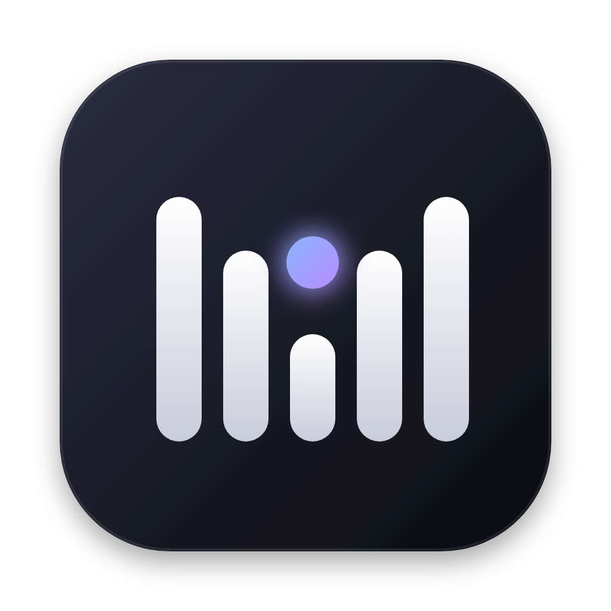

<p align="center"></p>

<h1 align="center">MeetCue</h1>

<p align="center">
  A floating meeting prompter for macOS.<br>
  It reads live captions off your meeting window, and with one hotkey asks your AI teammate what to say next.
</p>

<p align="center"><a href="#中文">中文说明</a></p>

---

## How it works

```
Meeting captions on screen ──OCR (on-device, ~0.2 s/frame)──▶ rolling transcript
                                                               │
                      ⌥1 … ⌥5  ──▶  last N minutes + your question ──▶ AI teammate
                                                               │
                                   answer appears in the floating window ◀┘
```

- **No audio capture, no meeting bot.** MeetCue reads the text your meeting app already shows
  (e.g. Feishu/Lark live captions or Minutes real-time transcript) using Apple Vision OCR on your Mac.
  Other participants see nothing.
- **Robust merging.** Captions scroll, re-wrap and get rewritten as people speak. MeetCue stitches
  frames into one continuous transcript by aligning each frame against the tail of what it already has,
  instead of de-duplicating line by line.
- **Ask with one key.** Hold <kbd>option</kbd> and press a number. MeetCue sends the recent transcript
  plus a preset question to the teammate you picked, and shows the reply in the overlay.
- **Hidden from screen sharing** by default.

### Transcript sources

| Source | Notes |
|---|---|
| Caption OCR (default) | Pick the meeting window, drag a box around the caption area once. Keep the window on the current desktop and not minimized. |
| [Cicada](https://github.com/wquguru/cicada) | If you already run Cicada, MeetCue can read its local live transcript instead (`~/Library/Application Support/LiveSubs`). |
| Manual paste | Paste a key sentence into the overlay when nothing else is available. |

### Answer backend

The bundled backend is a plugin for **Cindy** (`cindy-plugin/`): the question goes to a Cindy teammate
that already has your project memory, and the teammate sends the answer back through the plugin.
The client side lives in `app/src/bridge.cjs` (`targets()` and `ask()`), so another backend can be
plugged in by replacing that module.

## Hotkeys

Hold <kbd>option</kbd> (labelled <kbd>alt</kbd> on some keyboards), then press:

| Key | Action |
|---|---|
| 1 | What should I answer? |
| 2 | What should I ask or clarify? |
| 3 | What were they just talking about? |
| 4 | Progress & decision suggestion |
| 5 | Key recommendation |
| 0 | Cycle look-back window: 1 → 3 → 5 min → whole meeting |
| P | Switch teammate |
| H | Show / hide the overlay |
| esc | Stop waiting |

The settings panel has a **key test** mode that shows which key you pressed without sending anything.

## Build and run (macOS 14+; tested on Apple silicon)

Requires Node 20+ and Xcode command line tools (`swiftc`).

```bash
cd app
npm install
npm test
npm run build            # -> app/dist/MeetCue.app
open dist/MeetCue.app
```

First run:

1. Allow **System Settings › Privacy & Security › Screen & System Audio Recording** for MeetCue, then reopen it.
2. Install the Cindy plugin from `cindy-plugin/`, click **Connect Cindy** in the overlay, and confirm the
   pairing code on the plugin's **MeetCue 连接** page.
3. In your meeting, turn on live captions, select the meeting window, drag a box around the captions,
   and press **Start session**.

## Customising the questions

Create `~/Library/Application Support/Meeting Prompter/intents.json` to override or add questions
(keys 1–9):

```json
[
  { "key": "4", "label": "Weekly sync", "question": "Given the project's progress and commitments, what update or decision should I give now?" }
]
```

`settings.json` in the same folder accepts `"preferredPartner": "<part of the teammate's name>"` to choose the default teammate.

## Privacy

- Captured text stays in memory and is cleared when you end the session. The window snapshot used for picking the caption area is deleted right after you save the area. It is only sent when you press a hotkey, and only to the teammate you selected.
- A small diagnostics log (`diag.jsonl`) records events such as capture errors and idle periods. It never contains meeting text.

## Project layout

```
app/            Electron overlay (src/), Swift OCR helper (ocr-helper/), tests, build script
cindy-plugin/   Cindy plugin that relays questions to a teammate and returns answers
docs/           images
```

## License

[Apache-2.0](LICENSE). See [NOTICE](NOTICE) for credits.

---

## 中文

MeetCue 是一个 macOS 会中提词浮窗：在本机用 OCR 读取会议窗口里的实时字幕（例如飞书会议字幕、飞书妙记实时转写），按一下快捷键，就把最近几分钟的讨论和你的问题发给你选定的 AI 伙伴，回答显示在置顶浮窗里。

- **不录音，不进会。** 只读屏幕上已有的字幕文字，识别在本机完成，其他参会人无感。
- **字幕拼接稳。** 字幕会滚动、换行、改写，MeetCue 把每一帧和已有记录的结尾对齐拼接，不会丢字或重复。
- **一键提问。** 按住 option 再按数字：1 怎么回答，2 追问澄清，3 刚才在说什么，4 进度与决策，5 关键建议；option + 0 切换回看时长。
- **默认防截屏**，共享屏幕时对方看不到浮窗。
- 回答后端默认是 Cindy 插件（`cindy-plugin/`），由带项目记忆的 Cindy 伙伴回答；替换 `app/src/bridge.cjs` 即可接其他后端。
- 也可以读取 [知了 Cicada](https://github.com/wquguru/cicada) 的本机实时转写。

构建与首次使用见上文英文部分。许可证 Apache-2.0。
